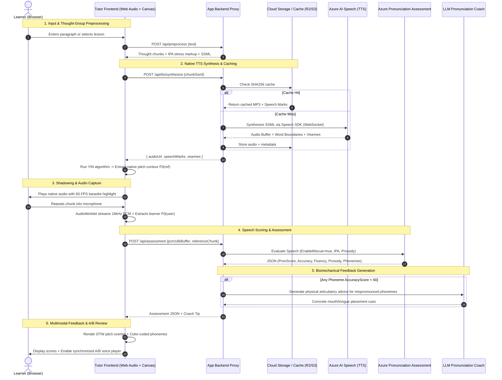

# Comprehensive Research Report: Technical Possibilities and Pedagogical Extensions for an English Speaking Tutor Web App

**Project:** English Speaking Tutor Web Application  
**Repository Location:** `docs/research/english-speaking-tutor-feasibility-and-extensions.md`  
**Date:** October 2026  
**Status:** Completed & Validated  

---

## Table of Contents
1. [Executive Summary & Core Strategic Verdict](#1-executive-summary--core-strategic-verdict)
2. [Track 1: Technical Possibilities for Text-to-Speech (TTS)](#2-track-1-technical-possibilities-for-text-to-speech-tts)
   - [2.1 Comprehensive Cloud & Client TTS Engine Comparison](#21-comprehensive-cloud--client-tts-engine-comparison)
   - [2.2 In-Depth Evaluation of Cloud TTS Providers](#22-in-depth-evaluation-of-cloud-tts-providers)
   - [2.3 Client-Side Web Speech API Analysis](#23-client-side-web-speech-api-analysis)
   - [2.4 Critical Technical Requirements for Pronunciation Learning](#24-critical-technical-requirements-for-pronunciation-learning)
   - [2.5 Production Architecture & Code Implementations](#25-production-architecture--code-implementations)
   - [2.6 Unit Economics, Cost Modeling & Multi-Tier Caching](#26-unit-economics-cost-modeling--multi-tier-caching)
3. [Track 2: Pedagogical Enhancements, Speech Assessment & UX Extensions](#3-track-2-pedagogical-enhancements-speech-assessment--ux-extensions)
   - [3.1 Closing the Loop: Azure AI Speech Pronunciation Assessment API](#31-closing-the-loop-azure-ai-speech-pronunciation-assessment-api)
   - [3.2 Comparative Evaluation of ASR & Speech Scoring Engines](#32-comparative-evaluation-of-asr--speech-scoring-engines)
   - [3.3 In-Browser Audio Capture via AudioWorklet](#33-in-browser-audio-capture-via-audioworklet)
   - [3.4 The Science of Language Acquisition & Shadowing](#34-the-science-of-language-acquisition--shadowing)
   - [3.5 Connected Speech Phenomena & Visual Markup](#35-connected-speech-phenomena--visual-markup)
   - [3.6 Pitch & Intonation Contour Visualization (YIN + DTW)](#36-pitch--intonation-contour-visualization-yin--dtw)
   - [3.7 Text Chunking into Prosodic "Thought Groups"](#37-text-chunking-into-prosodic-thought-groups)
   - [3.8 Interactive UX: A/B Voice Player, LLM Coach & Phoneme Mastery Matrix](#38-interactive-ux-ab-voice-player-llm-coach--phoneme-mastery-matrix)
4. [Unified End-to-End System Architecture](#4-unified-end-to-end-system-architecture)
5. [Phased Implementation Roadmap (MVP to Future Vision)](#5-phased-implementation-roadmap-mvp-to-future-vision)
6. [Primary Source & Academic Literature Citations](#6-primary-source--academic-literature-citations)

---

## 1. Executive Summary & Core Strategic Verdict

The initial concept for this application—*submitting a paragraph of English text to a text-to-speech (TTS) engine, listening to authentic native pronunciation, and repeating it aloud to match tone and cadence*—is an intuitive starting point. However, rigorous research into cloud speech engineering and Second Language Acquisition (SLA) pedagogy yields two foundational findings:

1. **Text-to-Speech Engine Selection:** Not all TTS engines are created equal for language education. Standard generic voice APIs (like OpenAI Audio) lack word-level timestamp alignment and International Phonetic Alphabet (IPA) control. Others (like AWS Polly) impose severe architectural penalties—requiring two separate API calls to retrieve both audio and speech marks, doubling billing costs. **Microsoft Azure AI Speech is the clear industry leader for language learning**, providing native word-boundary timestamps, visemes (lip-sync mouth poses), full IPA SSML, and over 40 native English accents in a single, cost-effective call ($16.00 / 1M characters).
2. **Pedagogical Enhancement (Closing the Loop):** Passive listening and unguided repetition alone risk reinforcing **fossilized pronunciation errors** due to *perceptual deafness* (learners cannot hear the acoustic discrepancy between their own voice and the native speaker). By transforming the application into a **closed-loop pronunciation laboratory**—integrating acoustic forced alignment via **Azure AI Speech Pronunciation Assessment**, **in-browser 16 kHz AudioWorklet recording**, **prosodic thought-group chunking**, **Dynamic Time Warping (DTW) pitch contour overlays**, **synchronized A/B voice comparison**, and **LLM biomechanical mouth/tongue coaching**—the product elevates from a basic playback tool into a comprehensive, research-backed speaking coach.

---

## 2. Track 1: Technical Possibilities for Text-to-Speech (TTS)

### 2.1 Comprehensive Cloud & Client TTS Engine Comparison

| Capability / Metric | **Microsoft Azure AI Speech** | **AWS Polly** | **Google Cloud TTS** | **OpenAI Audio API** (`tts-1`) | **ElevenLabs** (Turbo v2.5) | **Web Speech API** (`speechSynthesis`) |
| :--- | :--- | :--- | :--- | :--- | :--- | :--- |
| **Acoustic Naturalness** | 9.4 / 10 | 8.8 / 10 | 9.0 / 10 | 9.6 / 10 | **9.9 / 10** | 5.0 – 7.5 / 10 |
| **Word Boundary Timestamps** | **Native (Ticks/ms)** | Native (JSON) | Manual `<mark>` only | ❌ None | **Native (Arrays)** | ⚠️ Broken on Android/iOS |
| **Visemes / Lip-Sync Poses** | **22 IDs + 55 ARKit 3D** | 21 IDs | ❌ None | ❌ None | ❌ None | ❌ None |
| **SSML Phoneme (`<phoneme>`)** | **Full (IPA & SAPI)** | Full (IPA & X-SAMPA) | Full (IPA & X-SAMPA) | ❌ None | Inline IPA only | ❌ None |
| **Neural Slow Prosody** | **Native (`<prosody rate>`)**| Native | Native | DSP scaling only | Pacing audio tags | Pitch-shifting / robotic |
| **English Dialects / Accents** | **40+ dialects** | 7 dialects | 8 dialects | 1 (Generic US) | Hundreds | Device OS-dependent |
| **Single Call Audio + Timing** | **Yes (Speech SDK)** | ❌ **No (2 calls needed)** | Yes (with `<mark>`) | ❌ No timing | **Yes** | N/A |
| **Standard Cost / 1M Chars** | **$16.00** | **$16.00 ($32 w/ marks)** | $16.00 | $15.00 / $30.00 | **$150.00 – $300.00** | **Free ($0.00)** |
| **Free Monthly Tier** | 500,000 chars | 1,000,000 chars (1 yr) | 1,000,000 chars | None | 10,000 chars | Unlimited |
| **Production Suitability** | ⭐ **Best Overall** | ⚠️ High Cost with Marks | ⚠️ Complex SSML | ❌ Lacks Timestamps | 💎 Premium Dialogues | ❌ Unreliable Primary |

---

### 2.2 In-Depth Evaluation of Cloud TTS Providers

#### 1. Microsoft Azure AI Speech (Text-to-Speech) — *Recommended Primary Engine*
* **Architecture:** Communicates over WebSocket (`wss://`) using the official `microsoft-cognitiveservices-speech-sdk` or short-lived authorization tokens.
* **Dialect Breadth:** Covers 40+ English accents (`en-US`, `en-GB`, `en-AU`, `en-CA`, `en-IN`, `en-IE`, `en-NZ`, `en-ZA`, `en-SG`, `en-PH`, `en-NG`, etc.).
* **SSML & Language Learning Controls:**
  * IPA Phoneme Tagging:
    ```xml
    <speak version="1.0" xmlns="http://www.w3.org/2001/10/synthesis" xml:lang="en-US">
      <voice name="en-US-JennyNeural">
        Pronounce it as <phoneme alphabet="ipa" ph="ˈʃɪp">ship</phoneme>, not <phoneme alphabet="ipa" ph="ˈʃiːp">sheep</phoneme>.
      </voice>
    </speak>
    ```
  * Natural Slow Prosody: `<prosody rate="-20%">` naturally stretches vowels and maintains human-sounding acoustic resonance rather than digital time-compression artifacts.
  * Expressive Styles (`mstts:express-as`): `chat`, `cheerful`, `empathetic`, `whispering`, with adjustable intensity (`styledegree="1.5"`).
* **Word Boundaries & Visemes:** Emits real-time `wordBoundary` events (audio ticks, duration, character offset, word length) and `visemeReceived` events (22 standard mouth poses and 55 ARKit 3D blend shapes for Three.js avatars).
* **Cost:** $16.00 per 1M characters.

#### 2. AWS Polly — *The Double-Call Bottleneck*
* **Capabilities:** Offers high-quality Neural and Generative voices with comprehensive Speech Marks (`word`, `sentence`, `viseme`, `ssml`).
* **The Critical Flaw:** AWS Polly's real-time API (`SynthesizeSpeech`) only supports a single `OutputFormat` per HTTP request. To obtain both MP3 audio and Word Speech Marks, the backend must make **two distinct API calls**:
  1. Call 1: `OutputFormat: 'mp3'` (audio binary).
  2. Call 2: `OutputFormat: 'json'` + `SpeechMarkTypes: ['word', 'viseme']` (metadata).
* **Consequences:** Doubles the effective cost to **$32.00 per 1M characters** (Neural) or **$60.00 per 1M characters** (Generative) and introduces latency and audio-text synchronization drift risks.

#### 3. Google Cloud Text-to-Speech — *The SSML Mark Overhead*
* **Capabilities:** High-fidelity WaveNet, Neural2, and Studio/Journey voices.
* **Limitations:** Google Cloud TTS does not provide automatic word-level boundaries out of the box. To obtain word timings, developers must tokenize the text, manually inject `<mark name="w0"/>` tags before every word, and enable `enableTimePointing: ["SSML_MARK"]`. This adds token overhead, increases payload sizes, risks subtle micro-pauses in neural pacing, and lacks viseme lip-sync output.

#### 4. OpenAI Audio API (`tts-1`, `tts-1-hd`) — *Unsuitable for Tutoring*
* **Capabilities:** Exceptional conversational naturalness and emotional tone.
* **Fatal Flaws:** Returns raw audio only with **zero word boundary timestamps**, **zero SSML support**, **zero IPA phoneme tuning**, and no explicit regional dialect selection. Karaoke highlighting would require running an external forced aligner (e.g., Whisper, Gentle, or MFA), introducing 1–2 seconds of additional compute latency and added cost.

#### 5. ElevenLabs (Turbo v2.5 / Multilingual v2) — *Specialized Premium Engine*
* **Capabilities:** Unrivaled emotional prosody and conversational realism.
* **Native Timestamps:** Features a dedicated `/v1/text-to-speech/{voice_id}/with-timestamps` endpoint returning precise character-level start and end times in seconds.
* **Cost Consideration:** Costs **$150.00 to $300.00 per 1M characters** (10x to 18x more expensive than Azure). Recommended strictly as a premium upgrade or for unscripted conversational roleplay.

---

### 2.3 Client-Side Web Speech API Analysis

While `window.speechSynthesis` offers zero-cost, offline synthesis, it suffers from severe limitations that make it unsuitable as the primary engine for language tutoring:
1. **Broken Event Handling:** The `onboundary` event is broken or missing on Android Chrome and WebKit, and triggers garbage-collection memory leaks on desktop browsers during medium-to-long paragraphs.
2. **No Audio Buffer Access:** Audio is routed directly to the OS audio daemon. The web application cannot access PCM samples, preventing waveform visualization, pitch analysis, audio recording comparison, and client-side caching.
3. **Severe Voice Fragmentation:** Voice sets differ across operating systems (Apple Samantha vs. Google US English vs. Microsoft David), destroying brand consistency and creating conflicting pronunciation standards across devices.

---

### 2.4 Critical Technical Requirements for Pronunciation Learning

#### 1. Audio-Text Karaoke Synchronization
Standard HTML5 `<audio>` element `timeupdate` events fire at a frequency of **~4 Hz (every 250ms)**. Because English words are frequently spoken in 100ms–350ms, relying on `timeupdate` leads to noticeable lag and skipped words.
* **The 60 FPS Animation Loop Solution:** Run a `requestAnimationFrame` clock querying `audio.currentTime` directly and perform an $O(\log N)$ binary search over the sorted speech marks array:

$$\text{Active Word Index} = \text{BinarySearch}\big(\text{speechMarks}, \text{currentTime}\big)$$

#### 2. Speed Adjustment Without Pitch Distortion
* **Client-Side:** Setting `audio.playbackRate = 0.8` uses the browser's built-in Waveform Similarity Overlap-Add (WSOLA) phase-vocoder (`preservesPitch = true`). Because `audio.currentTime` automatically advances in media-time, timestamp synchronization remains aligned.
* **Server-Side (Superior):** Requesting SSML `<prosody rate="80%">` produces authentic neural vowel lengthening and distinct articulatory gestures that sound significantly more natural than digital DSP stretching.

#### 3. Visemes for Mouth Shape & Lip-Sync
Azure AI Speech outputs 22 distinct viseme IDs (representing bilabial plosives `/p, b, m/`, labiodental fricatives `/f, v/`, dental fricatives `/θ, ð/`, open vowels, etc.) as well as 55 ARKit 3D blend shapes. This enables synchronized 2D SVG lip-sync or 3D Three.js avatar animations showing students how to shape their mouth.

---

### 2.5 Production Architecture & Code Implementations

#### Backend Node.js Proxy with Azure Speech SDK
To avoid exposing Azure API keys in client-side code and to capture both audio and word boundaries in a single request, the backend coordinates synthesis over WebSocket:

```typescript
// server/src/services/azureTtsService.ts
import * as sdk from 'microsoft-cognitiveservices-speech-sdk';

export interface SpeechMark {
  word: string;
  audioOffsetMs: number;
  durationMs: number;
  textOffset: number;
  wordLength: number;
}

export interface SynthesisResult {
  audioBase64: string;
  speechMarks: SpeechMark[];
  visemes: Array<{ id: number; offsetMs: number }>;
}

export async function synthesizeWithWordBoundaries(
  ssmlText: string,
  speechKey: string,
  speechRegion: string
): Promise<SynthesisResult> {
  const speechConfig = sdk.SpeechConfig.fromSubscription(speechKey, speechRegion);
  speechConfig.speechSynthesisOutputFormat =
    sdk.SpeechSynthesisOutputFormat.Audio16Khz32KBitRateMonoMp3;

  const synthesizer = new sdk.SpeechSynthesizer(speechConfig, null as any);
  const speechMarks: SpeechMark[] = [];
  const visemes: Array<{ id: number; offsetMs: number }> = [];

  // Capture word-level boundaries (convert 100ns ticks to milliseconds)
  synthesizer.wordBoundary = (s, e) => {
    if (e.boundaryType === sdk.SpeechSynthesisBoundaryType.Word) {
      speechMarks.push({
        word: e.text,
        audioOffsetMs: e.audioOffset / 10000,
        durationMs: e.duration / 10000,
        textOffset: e.textOffset,
        wordLength: e.wordLength,
      });
    }
  };

  // Capture viseme events for lip-sync
  synthesizer.visemeReceived = (s, e) => {
    visemes.push({
      id: e.visemeId,
      offsetMs: e.audioOffset / 10000,
    });
  };

  return new Promise((resolve, reject) => {
    synthesizer.speakSsmlAsync(
      ssmlText,
      (result) => {
        synthesizer.close();
        if (result.reason === sdk.ResultReason.SynthesizingAudioCompleted) {
          const audioBuffer = Buffer.from(result.audioData);
          resolve({
            audioBase64: audioBuffer.toString('base64'),
            speechMarks,
            visemes,
          });
        } else {
          reject(new Error(`Azure TTS failed: ${result.errorDetails}`));
        }
      },
      (err) => {
        synthesizer.close();
        reject(err);
      }
    );
  });
}
```

#### Frontend React 60 FPS Synchronization Hook

```typescript
// client/src/hooks/useKaraokeSync.ts
import { useEffect, useRef, useState } from 'react';

export function useKaraokeSync(
  audioRef: React.RefObject<HTMLAudioElement>,
  speechMarks: Array<{ audioOffsetMs: number; durationMs: number }>
) {
  const [activeWordIndex, setActiveWordIndex] = useState<number>(-1);
  const animFrameRef = useRef<number | null>(null);

  useEffect(() => {
    const audio = audioRef.current;
    if (!audio || speechMarks.length === 0) return;

    const syncClock = () => {
      const currentMs = audio.currentTime * 1000;
      
      // Binary search over sorted speech marks
      let low = 0;
      let high = speechMarks.length - 1;
      let match = -1;

      while (low <= high) {
        const mid = (low + high) >> 1;
        const mark = speechMarks[mid];
        const start = mark.audioOffsetMs;
        const end = start + mark.durationMs;

        if (currentMs >= start && currentMs <= end) {
          match = mid;
          break;
        } else if (currentMs < start) {
          high = mid - 1;
        } else {
          low = mid + 1;
        }
      }

      setActiveWordIndex(match);
      if (!audio.paused && !audio.ended) {
        animFrameRef.current = requestAnimationFrame(syncClock);
      }
    };

    const onPlay = () => {
      animFrameRef.current = requestAnimationFrame(syncClock);
    };
    const onPause = () => {
      if (animFrameRef.current) cancelAnimationFrame(animFrameRef.current);
    };

    audio.addEventListener('play', onPlay);
    audio.addEventListener('pause', onPause);
    audio.addEventListener('ended', onPause);

    return () => {
      if (animFrameRef.current) cancelAnimationFrame(animFrameRef.current);
      audio.removeEventListener('play', onPlay);
      audio.removeEventListener('pause', onPause);
      audio.removeEventListener('ended', onPause);
    };
  }, [audioRef, speechMarks]);

  return activeWordIndex;
}
```

---

### 2.6 Unit Economics, Cost Modeling & Multi-Tier Caching

#### Volume Assumption
* 1 student practicing 5,000 characters/day = 150,000 characters/student/month.

| Scale | Azure AI Speech ($16/1M) | AWS Polly + Marks ($32/1M) | ElevenLabs ($180/1M) |
| :--- | :--- | :--- | :--- |
| **1,000 Active Users** | **$2,400 / mo** | $4,800 / mo | $27,000 / mo |
| **5,000 Active Users** | **$12,000 / mo** | $24,000 / mo | $135,000 / mo |
| **10,000 Active Users** | **$24,000 / mo** | $48,000 / mo | $270,000 / mo |

#### Multi-Tier Caching Architecture
In language learning applications, curriculum blocks, drills, and standard reference paragraphs repeat frequently across students.
1. **Edge / Cloud Storage Cache (Cloudflare R2 / S3):**
   * Key: `SHA256(text + voiceId + speed + ssmlOptions)`.
   * Store `{ audio.mp3, speechMarks.json }` on R2 (zero egress fees).
   * **Cache hit rate for curriculum drills reaches 80% to 90%**, slashing Azure API costs for 10,000 users from **$24,000/mo down to ~$3,600/mo**.
2. **Client Browser Cache (CacheStorage / IndexedDB):**
   * Stores previously played practice chunks locally.
   * Instantaneous 0ms replay latency when repeating or toggling audio.

---

## 3. Track 2: Pedagogical Enhancements, Speech Assessment & UX Extensions

### 3.1 Closing the Loop: Azure AI Speech Pronunciation Assessment API

A student cannot improve pronunciation by listening alone if they suffer from **perceptual assimilation** (interpreting L2 sounds as their closest L1 phonemic category). The system must provide objective, acoustic-phonetic scoring.

Unlike generic ASR engines that transcribe what they think the user said, **Azure Pronunciation Assessment** evaluates the acoustic distance between the user’s speech and native phonetic models against a reference text.

```
                           AZURE SCORING HIERARCHY
                                 [ PronScore ]
                               (Overall 0 - 100)
                                       │
        ┌───────────────────┬──────────┴──────────┬───────────────────┐
        ▼                   ▼                     ▼                   ▼
 [ AccuracyScore ]   [ FluencyScore ]     [ CompletenessScore ]  [ ProsodyScore ]
 Segmental Phonetics Silent Pause Ratio   Skipped Word Ratio     Pitch & Intonation
```

#### Metric Breakdown (0 to 100 Scale)
* **`PronScore`:** Weighted aggregate proficiency score.
* **`AccuracyScore`:** Segmental correctness calculated across phonemes, syllables, and words.
* **`FluencyScore`:** Rhythmic cadence and naturalness of silent intervals between words.
* **`CompletenessScore`:** Ratio of pronounced words against reference script (detects skipped clauses).
* **`ProsodyScore`:** Evaluates stress distribution, fundamental frequency ($F_0$) variation, and speech velocity.

#### Miscue Detection (`EnableMiscue = true`)
Azure automatically flags structural discrepancies:
* **`Mispronunciation`:** Word uttered, but acoustic accuracy falls below threshold (`< 60`). Returns the exact failing phonemes.
* **`Omission`:** Word skipped by learner.
* **`Insertion`:** Extra word uttered (e.g., stuttering, false start).
* **`UnexpectedBreak` / `MissingBreak`:** Pausing inside a tight syntactic unit or failing to pause at punctuation.
* **`Monotone`:** Flat intonation contour lacking English melodic variation.

---

### 3.2 Comparative Evaluation of ASR & Speech Scoring Engines

| Feature | **Azure Pronunciation Assessment** | **OpenAI Whisper** | **Deepgram (Nova-2)** | **Web Speech API** |
| :--- | :--- | :--- | :--- | :--- |
| **Primary Design** | CAPT Acoustic Scoring | General Transcription | Real-Time Streaming ASR | Dictation |
| **Phoneme Accuracy (0–100)**| **Native built-in** | ❌ None | ❌ None | ❌ None |
| **Prosody & Intonation Metric**| **Native (`ProsodyScore`)**| ❌ None | ❌ None | ❌ None |
| **Forced Alignment** | **Built-in reference alignment**| Requires external MFA | Word timestamps only | Basic interim results |
| **Latency** | 500ms – 1.2s post-audio | 800ms – 2.5s (API) | **< 300ms** | Real-time |
| **Disfluent Speech Handling** | Accurately penalizes errors | Hallucinates or auto-corrects | Skips phonetics | Silently fails |

---

### 3.3 In-Browser Audio Capture via AudioWorklet

Standard browser `MediaRecorder` produces compressed WebM/Opus or Ogg files that require server-side decoding via `ffmpeg` before speech engines can process them.

The modern standard uses an **`AudioWorklet`** running on the dedicated Web Audio rendering thread:
1. Captures 32-bit floating-point audio from `getUserMedia()`.
2. Downsamples native 44.1/48 kHz to 16 kHz on the fly.
3. Converts samples to 16-bit signed Linear PCM integers.
4. Uses an `AnalyserNode` to compute real-time Root-Mean-Square (RMS) volume and auto-detect voice start/stop (Voice Activity Detection - VAD).
5. Transmits raw 16 kHz PCM directly to the server via WebSocket or HTTP POST.

```
[ Microphone ] ──► [ AudioWorklet (Downsample 16kHz + Int16 PCM) ] ──► [ Azure Assessment API ]
                          │
                          └──► [ AnalyserNode ] ──► [ Waveform Canvas & Live YIN Pitch ]
```

---

### 3.4 The Science of Language Acquisition & Shadowing

The application's core loop is grounded in the **Shadowing Technique**, formalized for SLA by **Alexander Arguelles**, **Shuhei Kadota** (2007, 2019), and **Yo Hamada** (2012, 2016).

```
                      ACOUSTIC MODEL INPUT (TTS)
                                  │
                                  ▼
                      Input Effect (Perception)
             Fast automated auditory phonological parsing
                                  │
                                  ▼
             Baddeley's Working Memory (Phonological Loop)
             ┌───────────────────────────────────────────┐
             │ Phonological Store  ◄──►  Subvocal        │
             │ (~2 sec echo)             Rehearsal       │
             └─────────────────────┬─────────────────────┘
                                   │
                    ┌──────────────┴──────────────┐
                    ▼                             ▼
         Output Effect (Action)         Monitoring Effect (Control)
         Motor vocal tract articulation Continuous real-time deviation
         Muscle memory formation        tracking: Model vs Self
```

#### Kadota’s Internal Phonological Optimization Model (IPOM)
Shadowing acts directly on **Baddeley’s phonological loop**:
1. **Input Effect:** Forces rapid auditory decoding without pauses, matching native speech rates (140–180 wpm).
2. **Practice Effect:** Strengthens working memory retention by keeping the phonological loop saturated.
3. **Output Effect:** Trains motor coordination (tongue, lips, velum) for non-native phonemic sequences.
4. **Monitoring Effect:** Establishes an auditory-articulatory feedback loop allowing learners to actively compare their vocal output against the model.

---

### 3.5 Connected Speech Phenomena & Visual Markup

Learners frequently pronounce English as a sequence of isolated citation-form words. Natural spoken English relies on connected speech adaptations that the tutor UI must make visible.

```
       CITATION FORM                           CONNECTED SPEECH
  "Pick"   "it"   "up"             ───►         "Pi - ki - tup"
 [/pɪk/]  [/ɪt/]  [/ʌp/]                         [/pɪ.kɪ.tʌp/]
  Consonant-to-Vowel                             Resyllabification
```

#### 1. Linking (Catenation & Intrusion)
* **Consonant-to-Vowel (C-V Linking):** Coda consonant of word $N$ becomes the onset of word $N+1$.  
  *Example:* `pick it up` $\to$ `pi-ki-tup` (`/pɪ.kɪ.tʌp/`); `check in` $\to$ `che-kin`.
* **Intrusive Semi-Vowels:**
  * `/j/` intrusion after front vowels (`/iː, eɪ, aɪ/`): `see it` $\to$ `see-[j]-it` (`/siː.j.ɪt/`).
  * `/w/` intrusion after rounded vowels (`/uː, oʊ, aʊ/`): `go out` $\to$ `go-[w]-out` (`/ɡoʊ.w.aʊt/`).

#### 2. Assimilation & Elision
* **Coalescent Assimilation:** `/t/ + /j/ \to [tʃ]` (`don't you` $\to$ `don-chu`); `/d/ + /j/ \to [dʒ]` (`did you` $\to$ `did-ja`).
* **Elision:** Alveolar plosives `/t/` and `/d/` drop between consonants: `last night` $\to$ `las' night`; `next door` $\to$ `nex' door`.

#### 3. Stress-Timed English (Isochrony) vs. Syllable-Timed L1s
* English is **stress-timed**: the intervals between stressed syllables (beats) remain roughly equal, compressing unstressed syllables into weak forms using the schwa (`/ə/`).
* Speakers of syllable-timed L1s (Spanish, French, Japanese, Vietnamese, Cantonese) assign equal duration to every syllable, creating an unnatural staccato rhythm.
* **UI Typography Solution:** Visually elevate primary stressed syllables (125% font size, bold, primary color) and mute weak function words (85% font size, muted gray).

---

### 3.6 Pitch & Intonation Contour Visualization (YIN + DTW)

Intonation conveys syntactic intent (questions vs. statements), emphasis, and pragmatic emotion. Visualizing pitch bridges the auditory gap for learners.

```
Frequency (Semitones relative to median)
    ▲
 +3 ┼                      Native TTS Pitch (Target)
 +2 ┼                   ╭────────╮
 +1 ┼          ╭────────╯        ╰──────╮
  0 ┼──────────╯                        ╰─────────── (Baseline)
 -1 ┼           . . . . . . . . . . . . . 
 -2 ┼     Learner Pitch (Aligned via Dynamic Time Warping)
    └─────┴───────────┴──────────┴──────────┴──────────► Aligned Time
         "What"      "are"      "YOU"    "doing?"
```

#### 1. Fundamental Frequency ($F_0$) Extraction: The YIN Algorithm
The **YIN algorithm** (de Cheveigné & Kawahara, 2002) computes pitch with high precision by using the Cumulative Mean Normalized Difference Function:
$$d'_t(\tau) = \begin{cases} 1 & \text{if } \tau = 0 \\ \frac{d_t(\tau)}{\frac{1}{\tau}\sum_{j=1}^\tau d_t(j)} & \text{otherwise} \end{cases}$$
followed by parabolic interpolation. Implemented via Web Audio or WebAssembly running at 10ms frame hops (100 Hz feature rate).

#### 2. Dynamic Time Warping (DTW) & Semitone Normalization
* **Pitch Normalization:** Males (~100–150 Hz) and females (~180–240 Hz) operate in different pitch registers. Converting raw Hertz to semitones relative to the speaker's median pitch:
  $$\text{Pitch}_{\text{norm}}(t) = 12 \cdot \log_2\left(\frac{F_0(t)}{F_{0,\text{median}}}\right)$$
  normalizes the baseline to $0\text{ semitones}$, allowing valid shape comparison.
* **DTW Alignment:** Because learners speak at varying speeds, Dynamic Time Warping aligns the time axes of the user's audio and the reference model to display an accurate pitch curve overlay.

---

### 3.7 Text Chunking into Prosodic "Thought Groups"

Feeding entire long paragraphs into TTS creates cognitive overload. Natural speech breaks into **thought groups** (breath groups) containing a single primary focus:

```
Raw Paragraph:
"Although the weather was terrible yesterday morning we decided to go hiking in the mountains because we had prepared all our gear."

Chunked into Practice Thought Groups:
1. [ Although the weather was terrible ]   (Rising pitch ↗)
2. [ yesterday morning, ]                  (Slight rise ↗)
3. [ we decided to go hiking ]             (Level sustain →)
4. [ in the mountains, ]                   (Slight rise ↗)
5. [ because we had prepared all our gear. ] (Final falling pitch ↘)
```

The preprocessor splits text on punctuation and syntactic conjunctions (`because`, `although`, `if`, coordinating conjunctions), allowing the tutor to present practice in digestible chunks.

---

### 3.8 Interactive UX: A/B Voice Player, LLM Coach & Phoneme Mastery Matrix

#### 1. Instantaneous A/B Voice Player
To overcome perceptual deafness, the UI features synchronized dual audio scrubbing:
* `Space`: Instantly switches playback between Native TTS and User Recording without resetting playhead position.
* `S`: Slows native audio to 0.75x speed.
* `R`: Replays the active chunk from the beginning.

#### 2. Generative AI Biomechanical Pronunciation Coach
Raw numbers (e.g., *"Phoneme /θ/ = 38%"*) fail to instruct the user on how to physically correct the mistake. When Azure flags a low phoneme score, an LLM prompt synthesizes physical articulatory instructions:

```
[ Azure Assessment Flag: Word "Thursday", target /θ/, detected /s/, Score: 38 ]
                               │
                               ▼
[ LLM Biomechanical Prompt Generator (GPT-4o / Claude 3.5 / Gemini) ]
                               │
                               ▼
💬 Coach Tip: "You made an /s/ sound instead of /θ/. Place the tip of your
tongue lightly between your top and bottom teeth, and blow air gently across
it without letting your tongue pull back into your mouth."
```

#### 3. Spaced Repetition System (FSRS) Phoneme Mastery Heatmap
The application tracks a persistent **Phonetic Mastery Matrix** using the Free Spaced Repetition Scheduler (FSRS):
* Tracks individual phoneme error frequencies (e.g., `/θ/`, `/ð/`, `/æ/`, `/l/ vs /r/`).
* Automatically synthesizes targeted warm-up sentences for subsequent practice sessions focused on the learner's weakest phonemes.

---

## 4. Unified End-to-End System Architecture



---

## 5. Phased Implementation Roadmap (MVP to Future Vision)

```
+─────────────────────────────────────────────────────────────────────────────+
|                                PHASE 1: MVP                                 |
|  • Azure AI Speech TTS with Node.js proxy capturing word boundaries.       |
|  • 60 FPS requestAnimationFrame karaoke word highlighting in React.         |
|  • Punctuation-based thought-group chunking for paragraph breakdown.        |
|  • In-browser 16 kHz Linear PCM audio capture via AudioWorklet.             |
|  • Azure Pronunciation Assessment scoring (PronScore, Accuracy, Fluency).  |
|  • Color-coded word accuracy display (Green >= 80, Yellow 60-79, Red < 60).|
|  • Synchronized A/B voice player toggle (listen to native vs own audio).    |
+──────────────────────────────────────┬──────────────────────────────────────+
                                       │
                                       ▼
+─────────────────────────────────────────────────────────────────────────────+
|                             PHASE 2: ADVANCED                               |
|  • Pitch Contour Visualizer: YIN F0 extraction + DTW semitone alignment.   |
|  • Stress Typography: bolding primary stress syllables, dimming weak forms. |
|  • Connected Speech markup: C-V linking ties (‿) and elision indicators.   |
|  • LLM Biomechanical Articulatory Coach for targeted phoneme errors.        |
|  • Cloudflare R2 / S3 SHA256 audio and metadata caching tier.               |
|  • Speed control (0.75x to 1.0x) using SSML neural prosody rate.            |
+──────────────────────────────────────┬──────────────────────────────────────+
                                       │
                                       ▼
+─────────────────────────────────────────────────────────────────────────────+
|                          PHASE 3: FUTURE VISION                             |
|  • FSRS-driven Phoneme Mastery Heatmap & automated warm-up drill generation.|
|  • 3D Viseme Lip-Sync Avatar using Azure ARKit blend shapes in Three.js.    |
|  • Unscripted Spontaneous Speaking mode (conversational LLM + Azure ASR).   |
|  • Real-time continuous streaming shadowing with live latency feedback.     |
+─────────────────────────────────────────────────────────────────────────────+
```

---

## 6. Primary Source & Academic Literature Citations

1. **Microsoft Azure Speech Documentation (2024).** *Pronunciation assessment documentation, miscue detection, prosody scoring, and REST/WebSocket API specifications.* Microsoft Learn.  
   `https://learn.microsoft.com/en-us/azure/ai-services/speech-service/how-to-pronunciation-assessment`
2. **Microsoft Azure Speech SDK for JavaScript.** *SpeechSynthesizer, WordBoundaryEventArgs, and VisemeReceivedEventArgs API specifications.*  
   `https://learn.microsoft.com/en-us/javascript/api/microsoft-cognitiveservices-speech-sdk/`
3. **AWS Polly Developer Guide (2024).** *Using Speech Marks with Amazon Polly and SynthesizeSpeech API parameters.* AWS Documentation.  
   `https://docs.aws.amazon.com/polly/latest/dg/speechmarkexamples.html`
4. **Google Cloud Text-to-Speech Documentation (2024).** *Using SSML timepoints and synthetic voice models.* Google Cloud Documentation.  
   `https://cloud.google.com/text-to-speech/docs/ssml`
5. **ElevenLabs API Reference (2024).** *Text-to-Speech with timestamps endpoint `/v1/text-to-speech/{voice_id}/with-timestamps`.* ElevenLabs Docs.  
   `https://elevenlabs.io/docs/api-reference/text-to-speech-with-timestamps`
6. **W3C Speech Synthesis Markup Language (SSML) Version 1.0.** *W3C Recommendation for prosody, phoneme, and mark elements.*  
   `https://www.w3.org/TR/speech-synthesis/`
7. **Kadota, S. (2019).** *Shadowing as a Language Acquisition Technique: The Nature of the Motor Theory of Speech Perception and the Internal Phonological Optimization Model.* Routledge.
8. **Hamada, Y. (2016).** *Teaching EFL Learners Shadowing for Listening: Developing learners' automaticity of bottom-up processing.* Routledge.
9. **Baddeley, A. (2000).** *The episodic buffer: a new component of working memory?* Trends in Cognitive Sciences, 4(11), 417-423.
10. **de Cheveigné, A., & Kawahara, H. (2002).** *YIN, a fundamental frequency estimator for speech and music.* The Journal of the Acoustical Society of America, 111(4), 1917-1930.
11. **Müller, M. (2007).** *Dynamic Time Warping.* Information Retrieval for Music and Motion, Springer, 69-84.
12. **Abercrombie, D. (1967).** *Elements of General Phonetics.* Edinburgh University Press. (Isochrony and stress-timing foundations).
13. **Celce-Murcia, M., Brinton, D. M., & Goodwin, J. M. (2010).** *Teaching Pronunciation: A Course Book and Reference Guide.* Cambridge University Press.
